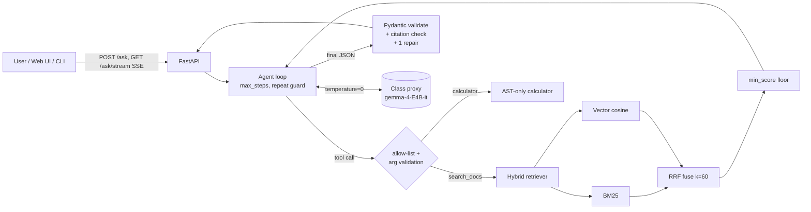

# KMITL Regulations Assistant

Ask questions about KMITL's official student regulations and guidebooks and get a cited answer, or a clear "not in the documents". An agent decides whether to search the documents, use a calculator (for GPA questions) or answer directly. Every answer is schema-validated, and every citation is checked against the passages the model was actually shown.

**Who it's for:** KMITL students, especially international students, who need answers like "how many credits can I register?", "what GPA gets me dismissed?" or "how long can I take leave?". Today those answers are buried in five long PDFs.

**Corpus:** five public PDFs linked from the KMITL Office of International Affairs ([oia.kmitl.ac.th/guidebook-regulation](https://oia.kmitl.ac.th/guidebook-regulation/)): the undergraduate and graduate regulations (2016), the undergraduate and graduate guidebooks (2022), and the general guidebook. The course reference app cannot answer questions about these. See [`data/sources.json`](data/sources.json).

## Course capability families covered

| # | Family | Where |
|---|---|---|
| 1 | Structured output + schema validation (one repair retry, citation allow-check) | `app/schemas.py`, `app/answer.py` |
| 2 | RAG: chunk → embed → index → hybrid retrieve (BM25 + vector, RRF) → cite | `app/ingest.py`, `app/store.py`, `app/retrieve.py` |
| 3 | **Retrieval evaluation**: hit@k, recall@k, MRR on a labelled set; baselines; chunk-size and `min_score` sweeps | `evaluation/` |
| 4 | **Agent loop with tools**: native function calling with a prompted-JSON fallback, allow-list, step cap, repeat-query guard | `app/agent.py`, `app/tools.py` |
| 6 | Served interface: FastAPI `POST /ask` and an SSE stream of agent steps with a small web UI | `app/api.py`, `app/static/index.html` |

## Architecture



## Setup

```bash
python -m venv .venv && source .venv/bin/activate
pip install -r requirements.txt
cp .env.example .env            # fill in OPENAI_API_KEY / OPENAI_BASE_URL (never commit .env)

python -m scripts.fetch_corpus  # downloads the 5 PDFs into data/raw/ and writes MANIFEST.json
python -m scripts.build_index   # chunk + embed -> data/index/
```

If Google Drive refuses the scripted download, open the `page` link in `data/sources.json`, save the PDF as `data/raw/<name>.pdf`, and rerun `fetch_corpus` to refresh the manifest. Commit the PDFs so the numbers can be reproduced.

**Embeddings:** the default `EMBED_PROVIDER=local` runs `all-MiniLM-L6-v2` on your machine. If the class proxy serves an embedding model, set `EMBED_PROVIDER=openai` and `EMBED_MODEL=<name>`. `tfidf` is an offline fallback that the unit tests use.

## Run

```bash
python -m scripts.ask "What is the maximum number of credits per regular semester?"   # agent
python -m scripts.ask "..." --mode rag --show-context                                  # single-shot RAG
python -m scripts.ask "..." --mode closed                                             # no-retrieval baseline
uvicorn app.api:app --reload    # open http://127.0.0.1:8000
```

```bash
curl -s localhost:8000/ask -H 'content-type: application/json' \
  -d '{"question": "How many semesters of leave can I take?", "mode": "agent"}'
```

## Evaluation (reproducible)

**1. Build the labelled set (about 30 items).** Gold labels are verbatim **evidence quotes**, not chunk ids, so the same labels work at every chunk size.

```bash
python -m scripts.draft_eval --n 40      # model drafts Q/A/evidence; the quote is checked to be verbatim
# hand-review data/eval/qa_draft.jsonl: fix wording (paraphrase, don't copy the PDF), check answers,
# set "verified": true, then:
cat data/eval/qa_draft.jsonl >> data/eval/qa.jsonl
# review the out-of-scope questions too, confirm the PDFs really don't answer them, then:
cat data/eval/unanswerable_seed.jsonl >> data/eval/qa.jsonl
```

Aim for about 24 answerable items (mix factual, numeric, keyword like form codes, and paraphrased) plus about 6 unanswerable ones. Add a few questions you wrote yourself as a student; model-drafted questions are easier than real ones.

**2. Retrieval: baselines, chunk size and `min_score`.** No LLM calls.

```bash
python -m evaluation.run_retrieval_eval --chunk-sizes 150,300,600
python -m evaluation.run_retrieval_eval --rerank      # optional: + LLM 1-10 reranker
```

This writes `evaluation/results/retrieval.md`:

- **Baselines:** BM25-only and vector-only, compared with hybrid RRF, on hit@1/3/5, recall@5 and MRR.
- **Measured improvement over a naive default:** the chunk-size sweep and the `min_score` sweep. The `min_score` sweep trades answerable hit@5 against correct abstention on unanswerable questions. Put the winning values in `.env` and say why in the report.

**3. End-to-end answers.** Closed-book baseline vs RAG vs agent.

```bash
python -m evaluation.run_answer_eval
```

This writes `evaluation/results/answers.md` (accuracy judged by an LLM against your reference answers, abstention accuracy, citation precision, schema validity, steps, latency) and `answers_items.jsonl`, the per-item outputs you'll use to pick failure cases for the report and demo.

## Safety and correctness

- Config comes only from the environment (`.env` is gitignored). The model runs at `temperature=0` everywhere.
- The model only *requests* tools. `app/tools.py` enforces an allow-list, validates and clamps arguments (`k` 1–8, query ≤300 chars), and the calculator walks a whitelisted AST (no `eval`).
- Tool output is wrapped as untrusted data, and the system prompt tells the model to ignore any instructions inside retrieved text.
- Final answers are validated with Pydantic. Citations to chunks the model never saw are dropped, and an answer with no valid citation gets one repair attempt, then abstains.
- If nothing clears `min_score`, the RAG path abstains without calling the model.

## Tests

```bash
pytest -q     # 25 offline tests: metrics, RRF, BM25 rare tokens, min_score, tools, agent loop (fake LLM)
```

## Layout

```
app/          config, llm client, ingest/chunk, embeddings, bm25, store, retrieve, schemas, answer, tools, agent, api
scripts/      fetch_corpus, build_index, draft_eval, ask
evaluation/   metrics, dataset (evidence-quote gold), run_retrieval_eval, run_answer_eval, results/
data/         sources.json, raw/ (PDFs + MANIFEST), eval/ (qa.jsonl)
tests/        offline unit tests with a fictional fixture corpus
```

## Known limitations

- PDF text extraction loses table structure, so grade tables and fee tables may chunk badly.
- The LLM judge is the same small model as the generator. Spot-check its verdicts by hand and report the agreement rate.
- The corpus covers English documents only. The 2016 regulations may have been amended since.
